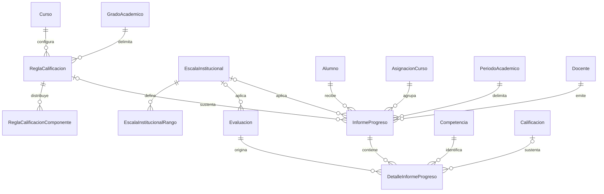
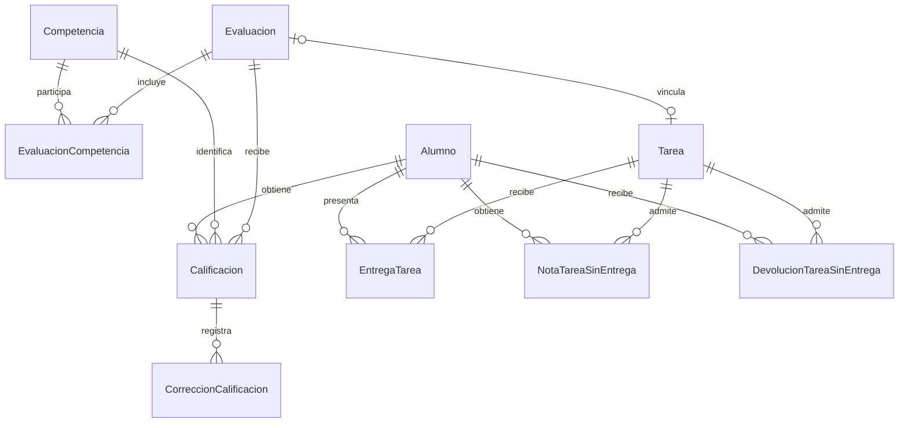

# Modelo académico de evaluaciones, tareas e informes

## Ponderaciones y libretas

Cada regla se versiona por curso y grado. Sus componentes almacenan los pesos por tipo de evaluación. Cada versión de la escala define rangos identificados por nivel. Tanto la evaluación como la libreta admiten una referencia opcional a la escala.

La combinación de alumno, asignación, periodo y número de versión identifica una libreta. Cada detalle conserva el título, la competencia, el nivel, la observación y el peso del resultado en el momento de generar esa versión. También puede registrar la nota numérica y el estado de la evaluación. La cabecera guarda el consolidado de la regla, las conclusiones descriptivas y la marca de revisión. La columna de auditoría `version` controla la concurrencia JPA.

## Evaluaciones y tareas

La clave única y opcional `Tarea.id_evaluacion_academica` permite una tarea independiente o una sola tarea por evaluación vinculada. Las entregas admiten respuesta escrita, nota y nivel de logro. Para un alumno sin entrega, la nota y la devolución se guardan por separado. Ambas son únicas por tarea y alumno. La nota exige exactamente uno de dos valores, una nota numérica o un nivel AD, A, B o C, y admite una observación. La devolución conserva el comentario docente.

## Creación y actualización en MySQL

El perfil `mysql` ejecuta las migraciones de [Flyway](../controller/src/main/resources/db/migration/) en orden y después Hibernate valida las entidades. Una base vacía se construye con ese mismo historial. La versión previa al PR #134 es V30. V31–V43 incorporan los cambios académicos de este diagrama y V44–V45 amplían otros módulos. El perfil `local` con H2 crea el esquema a partir de las entidades.

Para el flujo de generación, publicación y consulta, véase [libretas y PDF](US20_PDF_AVANCE.md).

### Comprobación sobre MySQL 8.0.44

Se verificaron dos rutas sobre bases desechables con el historial de `develop` en `eaf6ef09`.

| Estado inicial | Resultado |
| --- | --- |
| Base vacía | Flyway aplicó y validó las 46 migraciones hasta V45, incluida V1.5. |
| V30 con una evaluación publicada, calificación B, entrega con 17 puntos y libreta publicada | Tras aplicar V31–V45, la consulta por las claves originales devolvió la calificación B con su observación, la entrega con 17 puntos y la libreta publicada con su detalle B. La tarea histórica conservó su vínculo opcional vacío. |

Ambas bases terminaron con 85 tablas, incluido el historial de Flyway. La aplicación arrancó con el perfil `mysql` y Hibernate validó el esquema actualizado. Para comprobar además el comportamiento de las libretas, `InformeProgresoPersistenciaTest` cubre la unicidad de versiones y la conservación del detalle cuando cambia la calificación de origen.
