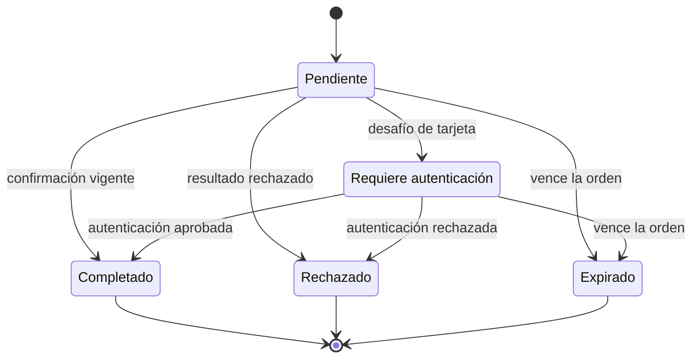
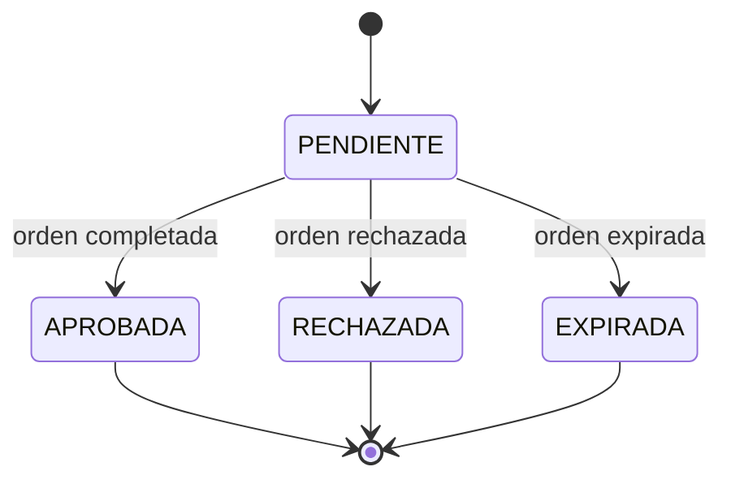

# Renovación anual y pagos simulados

La renovación anual tiene una bandeja propia en Matrícula. El apoderado elige una sección del grado siguiente y envía la solicitud. La institución registra el resultado oficial del grado anterior y toma la decisión. Al aprobar, el sistema registra la matrícula y sus diez pensiones en una sola operación.

## Renovación anual

| Estado del trámite | Qué ocurre |
| --- | --- |
| En revisión | El apoderado envió una solicitud. La vacante sigue disponible para otras matrículas hasta que se confirme la aprobación. |
| Aprobada | Administración confirmó la revisión. La matrícula y su plan quedaron registrados. |
| Rechazada | Se guarda el motivo que devolvió la validación o el motivo explícito de administración. Un nuevo envío puede abrir otro trámite después de corregir la causa. |

El resultado de promoción se registra desde **Matrícula → Renovación anual → Resultados de promoción**. Administración elige **Promovido** o **No promovido** y deja el sustento del acta. Se conserva auditoría, actor, fecha y versión. Un resultado que ya sustentó una renovación aprobada queda protegido. El consolidado por competencias sigue siendo una fuente de consulta académica. La promoción exige el resultado oficial.

Al confirmar la revisión, el servidor comprueba en este orden:

1. **Grado anterior.** El estudiante debe tener una matrícula válida y consecutiva, y resultado oficial **Promovido**. Si falta el resultado o indica que no aprobó, se conserva `GRADO_NO_APROBADO` con la explicación correspondiente.
2. **Deuda vencida.** Se consideran las obligaciones vigentes del estudiante con importe pendiente y vencimiento anterior al día actual de Lima. Vencer hoy todavía permite renovar. Un abono parcial mantiene el bloqueo si queda importe vencido. Pagos aprobados completos, compromisos anulados y exoneraciones quedan fuera de ese cálculo.
3. **Vacante.** Se vuelve a contar la ocupación de la sección elegida al decidir. La sección y su capacidad se protegen con el mismo bloqueo que la matrícula regular. Una sección completa, retirada o que dejó de corresponder al destino produce `SECCION_SIN_VACANTES`.

Para una aprobación se requiere una vista previa vigente del plan de pensiones. Si falta la tarifa o cambió la vista previa, el trámite permanece en revisión hasta corregir la configuración y volver a confirmar. Si se aprueba, la matrícula, las pensiones y la decisión se guardan juntas. El año de destino debe estar activo y su recepción abierta al enviar. La decisión puede continuar sobre solicitudes ya recibidas si se cierra la recepción mientras se revisan, siempre que el año siga activo.

Los flujos de nuevo ingreso y renovación tienen pantallas, solicitudes y decisiones diferenciadas. Se impide crear o finalizar un nuevo ingreso para saltarse la renovación de un alumno con historial válido anterior. El expediente técnico generado después de aprobar utiliza la matrícula existente y aparece en su historial. Un alumno con interrupción de estudios, traslado, repitencia o egreso de quinto necesita una regla institucional de reingreso o continuidad antes de ampliar ese alcance.

### Revisión de la carga masiva inicial

La plantilla Excel vigente importa **fichas de estudiantes**. Cada fila válida llama a la misma creación de ficha y los conflictos se reportan por fila. Ese flujo permite registrar identidades de un grupo nuevo. La aprobación de matrícula se mantiene como trámite posterior y reutiliza la ficha. Para evitar duplicaciones, conviene reconciliar código institucional y documento antes de la carga, especialmente si hay filas sin documento. Una futura importación de matrículas completa requeriría prevalidación separada, uso de identificadores de fichas existentes, verificación de vacantes, trazabilidad por fila y generación del plan sin duplicados.

## Orden de pago y transacciones

La **orden** representa el intento de checkout que el apoderado sigue en pantalla. Contiene una **transacción por obligación**. Todas comienzan pendientes y el servidor aplica el resultado de la orden en una sola operación. Si se pide autenticación adicional para una orden existente o en pruebas de backend, la transacción permanece pendiente hasta recibir el resultado.

| Resultado | Estado de cuenta y detalle | Historial de pagos | Seguimiento de pagos |
| --- | --- | --- | --- |
| Orden pendiente | El importe continúa pendiente. El detalle muestra el intento. | Se incorpora cuando termina. | Muestra la orden vigente, con la opción de continuar. |
| Orden completada | Actualiza importe pagado, saldo y estado en el mismo cierre. | Aparece la constancia de cada obligación pagada. | La orden sale de la lista de operaciones en curso. |
| Orden rechazada | Conserva la deuda y registra el resultado del intento. | Muestra el resultado y el motivo del rechazo. | La orden sale de la lista de operaciones en curso. |
| Orden expirada | Conserva la deuda y permite iniciar otra orden desde Obligaciones. | Muestra el intento como **Vencido**. | La orden sale de la lista de operaciones en curso. |

Si la orden expira con la ventana de pago abierta, el aviso **Se acabó el tiempo para pagar** aparece cuando el servidor confirma el estado. **Volver a Obligaciones** cierra la ventana y permite iniciar otra orden.

El servidor rechaza con **409 TRANSICION_PAGO_INVALIDA** las transiciones fuera de secuencia, como aprobar una orden vencida o rechazar una orden ya completada. Repetir la confirmación ya asentada de un mismo resultado permite recuperar la respuesta sin duplicar transacciones ni comprobantes. Una autenticación adicional exige un desafío pendiente. Los registros históricos que usen otros estados permanecen consultables según sus reglas.

La pantalla familiar de obligaciones permite filtrar **Pensiones** y **Actividades y servicios** antes de paginar. **Todos los conceptos** mantiene visibles las obligaciones históricas sin clasificación y permite seleccionar varios conceptos en la misma orden, con una transacción y una constancia por obligación aprobada. Una propuesta opcional sigue en su propia pestaña y pasa al estado de cuenta como obligación únicamente si el apoderado la acepta.

## Experiencia de pago y alcance de la simulación

- **Tarjeta.** El apoderado revisa el estudiante, concepto e importe de cada obligación y completa número, titular, vencimiento y código de seguridad con datos ficticios. El botón muestra el total en soles. El navegador envía únicamente la referencia de la tarjeta de prueba.
- **QR.** El código lleva a la billetera de la institución, en el celular o en el mismo dispositivo. La billetera presenta el importe y la confirmación. El QR tiene vigencia de cinco minutos y el checkout consulta el estado mientras espera. Seguimiento refresca las órdenes vigentes y las otras vistas cargan el resultado al visitarlas.
- La interfaz identifica el carácter simulado. Los distintos resultados se reproducen ingresando las tarjetas del catálogo. `PAYMENTS_SIMULATOR_ALLOW_TEST_SCENARIOS` permanece desactivada por defecto y controla las acciones de prueba directas del API. Para una presentación se mantiene ese valor y se habilita el checkout con `PAYMENTS_SIMULATOR_ENABLED`.
- Se conserva el cálculo en PEN por el servidor, la identidad de sesión y las asociaciones familiares, la protección ante órdenes que se superponen, la vigencia del QR firmado y los comprobantes internos. Una pasarela real queda como mejora opcional.

### Cómo probar el formulario de tarjeta

Selecciona una pensión o un cargo de **Actividades y servicios** y elige **Tarjeta**. Usa un titular ficticio, por ejemplo **Ana Prueba**, y un mes vigente, por ejemplo **12/35**. Los ejemplos de 16 dígitos usan el CVV ficticio **123**. El ejemplo de 15 dígitos usa **1234**.

| Número ficticio | Resultado esperado |
| --- | --- |
| `4242 4242 4242 4242` o `3782 822463 10005` | Aprobación y acceso a las constancias. |
| `4000 0000 0000 9995` | Fondos insuficientes. |
| `4000 0000 0000 0069` | El simulador devuelve tarjeta vencida aunque se haya ingresado una fecha vigente. Una fecha pasada produce un error en el campo antes de confirmar. |
| `4000 0000 0000 0002` | Tarjeta bloqueada o inválida. |
| `4000 0000 0000 0127` | Código de seguridad incorrecto. |
| `4000 0000 0000 0119` | Límite excedido. |
| `4000 0000 0000 0341` | Compras por internet no habilitadas. |
| `4100 0000 0000 0019` | Rechazo genérico por seguridad. |
| `4000 0025 0000 3155` | Verificación adicional dentro de la misma orden. |
| `4000 0000 0000 0259` | Servicio temporalmente no disponible. Consulta la orden antes de volver a confirmar. |
| `4000 0000 0000 0077` | Respuesta de confirmación agotada. Consulta la misma orden para recuperar el resultado. |

**Seguimiento** permite recuperar una orden vigente o con resultado por confirmar. **Historial** muestra los intentos finalizados y permite abrir las constancias de los pagos aprobados. Un rechazo conserva el estado financiero de cada obligación y una aprobación cierra todos los cargos de la orden en una transacción. El formulario trabaja sobre el saldo pendiente de cada cargo en soles.

## Evidencia y preguntas para el equipo

| Caso | Resultado que debe verse |
| --- | --- |
| Promovido, al día y con vacante | En revisión después del envío. Aprobada al decidir. Matrícula nueva y diez pensiones. |
| Grado anterior no aprobado | Rechazada por grado no aprobado. El apoderado consulta el motivo. |
| Saldo vencido | Rechazada por deuda, incluso si el alumno ya hizo un abono parcial. |
| Última vacante ocupada después del envío | Rechazada por falta de vacante. La aprobación anterior conserva su plaza. |
| Pago aprobado | Estado de cuenta actualizado, comprobante disponible y orden completada. |
| Confirmación vencida o contradictoria | Transición rechazada. Se conserva el resultado definitivo y el saldo correspondiente. |

La migración **V17** registra promociones y trámites conservando las matrículas previas. Flyway la aplica después de las migraciones de evidencias pedagógicas (V15) y códigos institucionales (V16). Validar la actualización en una copia de MySQL. Para la exposición, preparar un año anterior con sus actas, un año siguiente activo con admisión abierta y una tarifa para cada grado de destino utilizado. Usar una sección disponible y otra completa con estudiantes ficticios.

Para demostrar la renovación, enviar desde el perfil del apoderado y abrir el trámite desde el perfil administrativo. Después de confirmar la revisión, volver al perfil del apoderado y consultar el resultado. En el caso aprobado, comprobar las diez pensiones del nuevo año en Estado de cuenta.

Para demostrar el QR, seleccionar una pensión y abrir el checkout en la computadora. Escanear con un celular que pueda acceder a `FRONTEND_URL`, confirmar desde la billetera y comprobar que el checkout muestra la constancia sin recargar. Después, revisar la pensión en Estado de cuenta, la salida de la orden de Seguimiento y la constancia en Historial. En otra obligación, se puede dejar vencer el QR y comprobar que la deuda sigue pendiente.

La verificación tras integrar `develop` pasó con 661 pruebas del backend y 759 del frontend, con los umbrales de cobertura del proyecto. La migración se comprobó en H2 en modo MySQL. La validación en MySQL y el escaneo desde un celular quedan pendientes de prueba manual.

El Product Owner puede validar si las renovaciones necesitan una ventana distinta a la admisión, qué procedimiento corresponde si se rectifica un acta después de aprobar, qué tratamiento tendrán las interrupciones o repitencias, y si foto o certificado médico se convertirán en requisitos. El alcance actual los mantiene como propuestas.
